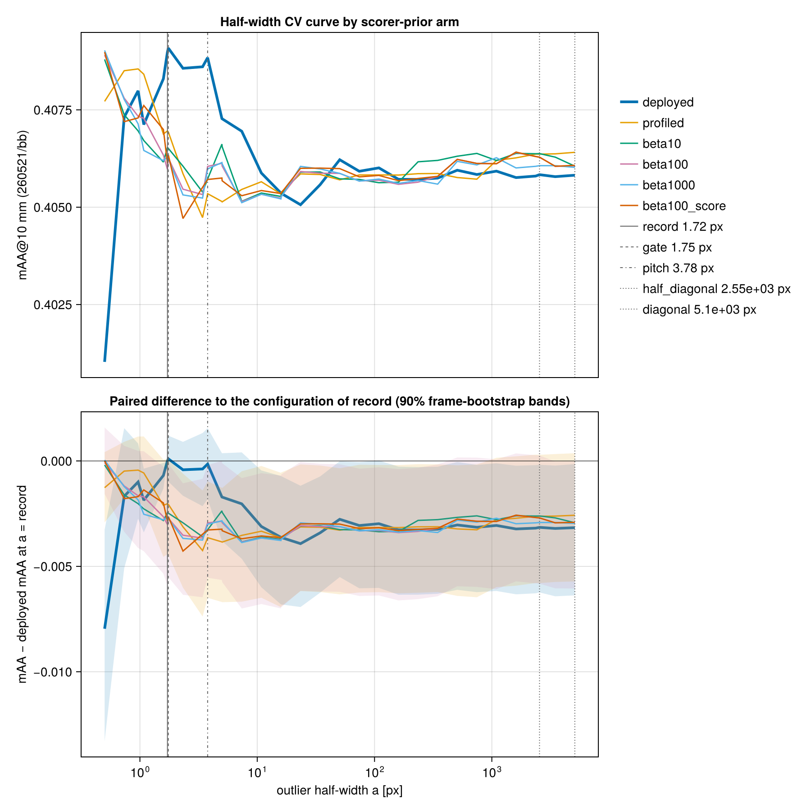
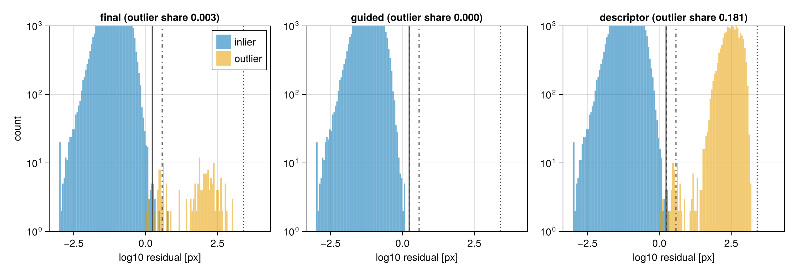
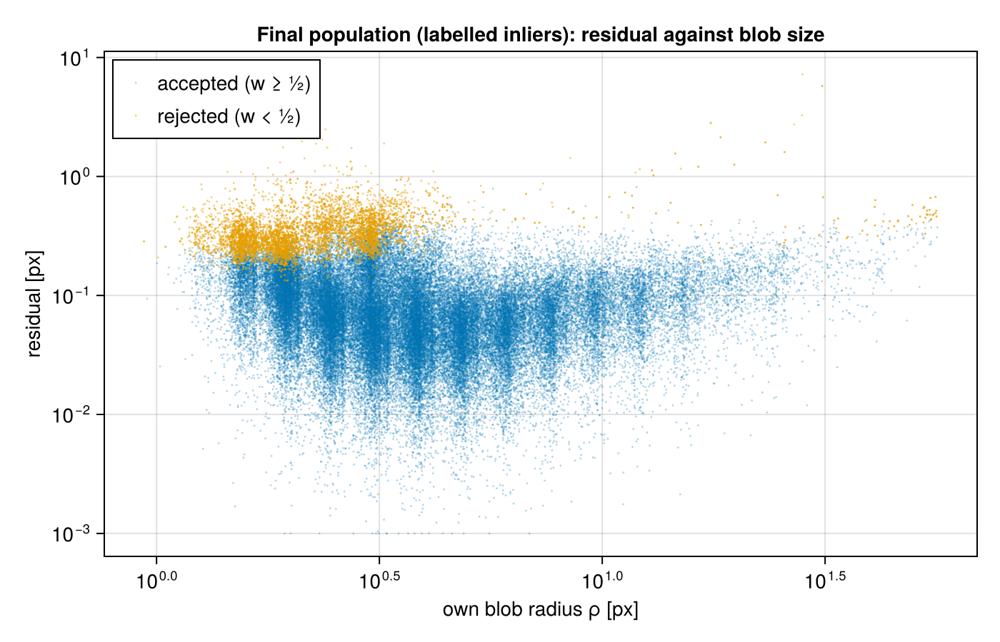
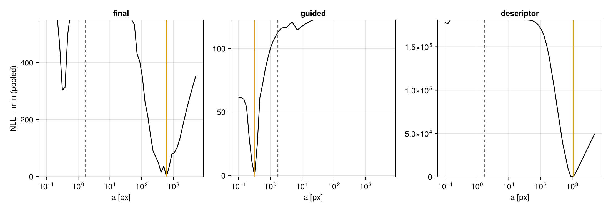
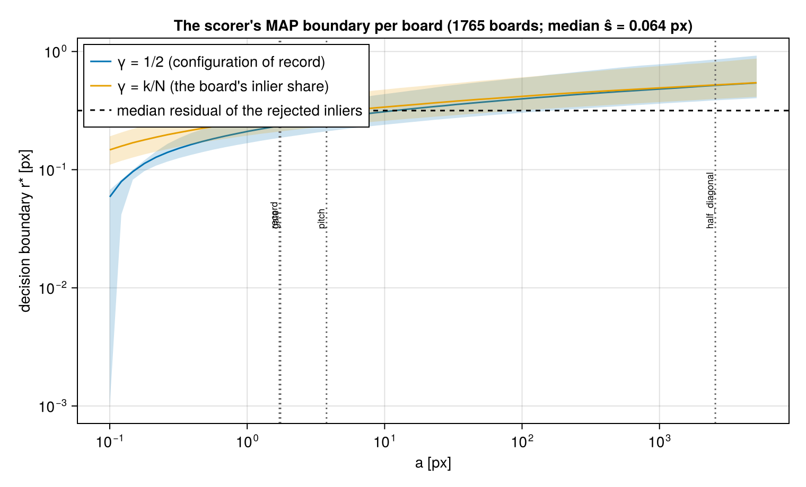

# Why is the cross-validated outlier half-width so small?

A study, 2026-11-22. It changes no record, no config of record and no release.
Branch `exp/halfwidth-study`; driver `bmvc2026/scripts/halfwidth_study.jl` with
config `bmvc2026/configs/halfwidth_study.toml` (VGTK Eval Experiments: one
keyed Product per stage, `--stage=residuals`, `--stage=arm --arm=<name>`,
`--stage=report`). The split, criterion, panel, inputs and run config are the
half-width CV's own (`[study] cv = "halfwidth_cv.toml"`, its key folded into
every product's): tune on 260521/bb (80 frames, 435 board pairs), 260527 never
read, inter-board relative-pose translation mAA@10 mm, detector setting A
(upsample 2, nb_scales 3, nb_octaves 10).

Runs: vcai-eaic-mds, nereus and iris (RTX PRO 6000), BlobBoards at `f06eb5f`
(this branch), Core 0.13.1, Estimation 0.12.2, Eval 0.10.1, Features 0.9.11,
LocalOptimizationDoneRight 0.7.2 (path-sourced, unregistered). Results root
`/cluster/projects/vgtk/results/experiments/bb-halfwidth-study/tuning/bmvc2026/`:
residuals `halfwidth_residuals/1e8a967cc510b372`, report
`halfwidth_report/db6c5315f4daf561` (its `summary.toml` is copied beside the
figures). The deployed arm reproduces the curve of record (0.4071 at 1.08 px,
0.4086 at 2.33, 0.4073 at 5, 0.4054 at 16; record 0.4078 / 0.4089 / 0.4071 /
0.4053).

## The finding in one paragraph

The deployed scorer does not profile the inlier fraction. Its label prior is
`flat` (γ = ½; Estimation's `configs/default.toml [scoring.student_t_uniform]`),
and the Stu-tU-IRLS local optimization holds π at the seed's ½ (Estimation's
`PosteriorLikelihood` default `FixedPrior(inlier_prior(rws))`, and
`seed_posterior!` resets π to ½). The MAP rule is therefore exactly
t(r)·(2a)² > 1. In that rule the half-width does not describe where outliers
lie. It sets a decision boundary, and the boundary moves only with √log a.
On the boards the scorer actually fits there are almost no outliers. The guided
set has none, and the final set has 0.26 %, at a median of 74 px. So the CV
uses a to trim the tail of correct correspondences. At a = 1.7 px the scorer
rejects 9.2 % of the geometrically correct correspondences (median residual
0.32 px), mostly on the smallest blobs, and that trimming is what raises the
pose mAA. The image-scale expectation is right only for the RANSAC stage's
descriptor matches. Their outliers really do span the image: the ML support is
about 1100 px. That difference does not reach the criterion: from 16 px to
5096 px the curve stays within 0.0012.

## 1. The CV curve on an extended grid (experiment 1)



The grid is log-spaced over 0.5–5096 px at 6 per decade. It adds the record
values (0.9646, 1.716), 5 and 16 px, and the measured values: the gate is
1.75 px and the lattice pitch 3.78 px (the medians over the fitted candidates'
own blobs, §2), the half-diagonal 2549 px and the diagonal 5099 px. In the
bottom panel each curve is the paired difference to the deployed arm at
a = 1.716 px, with a 90 % frame-bootstrap band (1000 resamples, the same
resamples for every arm).

| deployed arm, a [px] | mAA | Δ vs 1.716 [90 % CI] | P(below 1.716) |
|---|---|---|---|
| 0.5 | 0.4010 | −0.0079 | — |
| 0.965 | 0.4080 | −0.0010 [−0.0027, +0.0008] | 0.82 |
| **1.716 (record)** | 0.4090 | 0 | — |
| 1.747 (gate) | **0.4091** (argmax) | +0.0001 [−0.0010, +0.0012] | 0.40 |
| 3.78 (pitch) | 0.4088 | −0.0001 [−0.0018, +0.0016] | 0.53 |
| 5 | 0.4073 | −0.0017 [−0.0038, +0.0004] | 0.92 |
| 16 | 0.4054 | −0.0036 [−0.0068, −0.0007] | 0.98 |
| 2549 (half-diagonal) | 0.4058 | −0.0032 [−0.0062, −0.0002] | 0.96 |
| 5099 (diagonal) | 0.4058 | −0.0032 [−0.0064, −0.0001] | 0.96 |

On the extended grid the argmax is 1.75 px, with a bootstrap argmin interval
of [0.73, 3.78] px. The image scale is worse than the optimum by 0.003 mAA
(about 0.8 %). The difference is just significant on 80 frames, and the curve
is flat from about 10 px to 5096 px. Boards found rise from 1765 to 1776 as a
grows.

## 2. Wrong-candidate residuals (experiment 2)



The data are one detection run and `find_boards` at the run config of record,
1765 boards in 80 frames. Each candidate's residual is the pose problem's own
(`mahalanobis_distances!`, px) at the refined pose. A candidate is an inlier
when its detection is nearer its own blob's projected centre than any other
blob's, and within one local pitch of it. Three populations:

| population | n | outliers | outlier residual q10 / q50 / q90 [px] | outliers ≤ own gate | outliers ≤ own pitch |
|---|---|---|---|---|---|
| final (what each board was fitted on: guided union + rejected descriptor matches) | 77 541 | 0.26 % | 2.4 / 74 / 413 | 0 % | 10.7 % |
| guided (IoU ≥ 0.5 association of the refined pattern, no keep set, no claims) | 68 439 | **0** | — | — | — |
| descriptor (the board's mutual-NN matches over the whole frame) | 90 790 | 18.1 % | 123 / 330 / 785 | 0 % | 0.14 % |

The **gate** is not a radius. Guided association has accepted by ellipse IoU
alone since 2026-11-11. For two equal regions, IoU ≥ 0.5 means a centre offset
of at most 0.530 ρ, where ρ = √(ab) of the blob's region at the board's cutoff
(Core's `iou`, bisected). Per fitted candidate the gate is 1.75 px
[1.00, 4.45] (median [10 %, 90 %]) and the local pitch 3.78 px [2.12, 8.45].
These boards carry many small blobs, so the gate and the pitch are both a few
pixels.

Guided association lets through no lattice-neighbour confusions and no wrong
candidates at all. Its residuals are all labelled inliers, with q99 0.63 px and
a maximum of 7.2 px. The few wrong candidates in the final set are rejected
descriptor matches, mostly far away; the deployed weights accept none of them.
Lattice confusion at one pitch does not occur in practice.

The deployed scorer is doing something else. In the final set it rejects
(weight < ½) **9.2 % of the geometrically correct correspondences** (7087 of
77 541). Their median residual is 0.32 px [0.22, 0.52]; the accepted residuals
have q99 0.30 px.



The rejected correct correspondences sit on small blobs. The median radius is
2.05 px for rejected inliers against 3.58 px for accepted ones. By blob-size
quintile, the residual q90 is 0.30 / 0.28 / 0.26 / 0.13 / 0.17 px and the
rejected share 25 % / 11 % / 7.7 % / 1.0 % / 1.2 %. The scorer assumes one
noise level per board (unit isotropic pixel noise, ŝ per board), but the
localization noise depends on blob size.

## 3. Joint ML fit of a and π (EM) (experiment 3)



This is the mixture of a two-dimensional Student-t (s, ν) and a uniform of
density (2a)⁻², fitted with Core's own blocks: `median_seeded_posterior`,
`update_weights!`, `update_scale!`, `update_nu!` and `update_inlier_prior!`,
with π estimated. The uniform is truncated to its support (a residual beyond
the disc of area (2a)² is an inlier). The fit is profiled over a on 12 points
per decade from 0.1 to 5096 px, pooled and per frame (65 frames with at least
50 residuals).

| population | pooled ML â [px] | π̂ | s [px] | ν | per-frame â, median [10 %, 90 %] |
|---|---|---|---|---|---|
| final | 606 | 0.9985 | 0.054 | 2.0 | 106 [0.32, 500] |
| guided | **0.32** | 0.985 | 0.050 | 3.0 | 0.32 [0.15, 0.47] |
| descriptor | **1083** | 0.82 | 0.052 | 2.1 | 339 [230, 1083] |

The descriptor population's outliers have image-scale support, which is the
original expectation, and its π̂ = 0.82 is close to its labelled outlier rate
of 18 %. The guided population has no outliers. There the "uniform" is fitted
to the inlier tail (â = 0.32 px), and the pooled Student-t is heavy (ν ≈ 2–3)
because it pools boards and blobs with different noise levels. None of the ML
fits lands near 1.7 px. In this parametrization the CV optimum is not an
estimate of the outlier support.

## 4. A prior on π (experiment 4)

The arms vary the scorer's label prior. The Core priors used are
`ProfiledLabelPrior` (γ̂ = k/N) and `BetaLabelPrior` (π integrated out). The
LO's π is either estimated (Core's `Estimated()`) or updated as a Beta MAP
under the same prior (`BetaMapPrior`, the only new block). The Beta prior is
centred on the final population's inlier rate m = 0.9974; κ is its strength.

| arm (score prior / LO π) | best a [px] | best mAA | argmin 90 % interval | a = 1.716 | a = 2549 |
|---|---|---|---|---|---|
| deployed (flat ½ / held ½) | 1.75 | 0.4091 | [0.73, 3.78] | 0.4090 | 0.4058 |
| profiled (k/N / estimated) | 0.965 | 0.4086 | [0.5, 1.08] | 0.4070 | 0.4064 |
| beta κ = 10 (Beta / Beta MAP) | 0.5\* | 0.4088 | [0.5, 5.0] | 0.4065 | 0.4064 |
| beta κ = 100 | 0.5\* | 0.4089 | [0.5, 1.08] | 0.4060 | 0.4063 |
| beta κ = 1000 | 0.5\* | 0.4090 | [0.5, 0.97] | 0.4063 | 0.4061 |
| beta κ = 100, score only (LO π held ½) | 0.5\* | 0.4090 | [0.5, 1.59] | 0.4061 | 0.4063 |

\* At the grid's lower edge, so the arm's optimum lies at a ≤ 0.5 px.

**The optimum moves down, not up.** A realistic π (≈ 0.997) multiplies the
inlier odds by π/(1 − π) ≈ 380, which pushes the boundary out. The CV then
pulls a down to put the boundary back. No arm beats the deployed peak: every
best is within 0.0005 of 0.4091. At the image scale the prior arms are 0.0003–
0.0006 better than the deployed arm, still 0.0026–0.0029 below the record (paired
P(below) 0.92–0.95). A prior on π does not make the uniform an image-scale
outlier model: a only re-parametrizes one threshold.

## 5. The implied decision threshold (experiment 5)



These are the boundaries of the scorer's own MAP rule, Core's
`decision_boundary` on `GauInlier`, computed board by board. Each board's
consensus Student-t is Core's `partition_student_t` (Jeffreys prior, the LO
seed's m + 1 = 4, d = 2) over its accepted set; the median ŝ is 0.064 px
[0.047, 0.092]. The table gives the median [10 %, 90 %] over 1765 boards:

| a [px] | r* at γ = ½ (deployed) | r* at γ = k/N | share of correct candidates kept (γ = ½, pooled boundary) |
|---|---|---|---|
| 0.965 (record 2026-10) | 0.21 [0.17, 0.28] | 0.28 | 92.6 % |
| 1.716 (record) | 0.24 [0.19, 0.32] | 0.31 | 96.9 % |
| 1.747 (gate) | 0.24 [0.19, 0.32] | 0.31 | 97.0 % |
| 3.78 (pitch) | 0.27 [0.21, 0.37] | 0.34 | 99.3 % |
| 5 (paper) | 0.28 [0.22, 0.39] | 0.35 | 99.6 % |
| 2549 (half-diagonal) | 0.52 [0.39, 0.86] | 0.60 | 100 % |

(The last column applies the pooled-fit boundary, 0.27–14.5 px, to the final
population's labelled inliers. No labelled outlier is kept at any a below the
half-diagonal, where 32 % of the final set's few outliers would be.)

A 1500× change in a moves the boundary only 2.2×, from 0.24 to 0.52 px, about
3.7 ŝ to 8 ŝ. The CV's optimum corresponds to r* ≈ 0.24 px ≈ 3.7 ŝ. The
prior arms' optima at a ≤ 0.5 px with π ≈ 0.997 give about the same boundary
(≈ 0.28 px, Gaussian approximation at ŝ = 0.064). In every arm the CV selects
a decision boundary, not an outlier support. For scale, at π = 0.9974 a true
outlier support a_true corresponds to a = 19.4 a_true in the deployed
(γ = ½) rule, so 1.716 px stands for a_true ≈ 0.09 px.

## Hypotheses

- **H1, selection: supported, with a correction.** The candidates the final
  fit scores are pre-selected: the guided set has no wrong candidates and the
  final set 0.26 %. The outlier support is not the gate or the pitch, though.
  No outlier falls within its gate, and the gate lets through no lattice
  confusions. The RANSAC stage's descriptor outliers do span the image (ML
  â ≈ 1100 px). That 1.75 px gate ≈ 1.716 px CV optimum is a coincidence
  under this evidence.
- **H2, a confounded with π: supported, in a stronger form.** π is not
  profiled in the deployed code. It is held at ½ in both the score and the
  LO, so a is exactly the decision-threshold knob. With π profiled or under
  a Beta prior, the optimal a moves down (to ≤ 0.5–1 px), and the selected
  boundary stays at about 0.24–0.3 px.
- **H3, Student-t tails absorb moderate errors: not supported as stated.** Per
  board the scorer's Student-t is nearly Gaussian (ν = 2(k − 4), tens to
  hundreds), and it does not absorb moderate errors. The uniform takes them
  instead, rejecting 9 % of correct correspondences at 0.2–0.5 px. The heavy
  pooled tails (ν ≈ 2–3) come from heteroscedastic noise across blobs, which a
  single per-board ŝ cannot represent.
- **H4, the criterion is not the likelihood: supported.** The likelihood's
  support is 0.32 px (guided) or about 600–1100 px (final, descriptor), while
  pose mAA prefers a = 1.75 px, which trims noisy small-blob correspondences.
  The gain is small: 0.003 mAA over the image scale, and flat from 10 px to
  5096 px.

## Recommendations

1. **Do not set a from the gate or the pitch.** That would change the
   parametrization without changing the mechanism: neither describes where the
   scorer's outliers lie. The value 1.716 px is fine as a *tuned threshold*.
   Its documentation (`[find_boards.geometry] outlier_halfwidth`: "the support
   of the uniform outlier component") should say that, with γ = π = ½, it sets
   the MAP boundary at ≈ 3.7 ŝ (≈ 0.24 px here). It does not describe where
   outliers lie.
2. **A prior on π does not pay on this criterion.** Profiled and Beta(m·κ,
   (1 − m)·κ) priors tie the deployed peak (−0.0001 to −0.0005), and the a they
   select is smaller and less interpretable. If π is to become explicit for
   interpretability, set it with the boundary in mind: a ≈ 0.5 px with
   π ≈ 0.997 is the same rule.
3. **The real lever is the noise model.** The CV is trimming correct but noisy
   small-blob correspondences. Weighting each correspondence by its
   detection's localization covariance (the adapted ellipse's scale, or
   Features' frame covariance) would treat that noise directly, instead of
   rejecting 9 % of correct correspondences. A two-stage half-width would
   also match the populations measured here: image-scale for the RANSAC
   (descriptor) stage, the trimming boundary for the guided refit. Both are
   follow-up experiments, not changes to the scorer here.

## Reproduce

```
# per node: hw.sh (cluster: /cluster/projects/vgtk/logs/store/bb-halfwidth/hw.sh) resolves the
# bmvc2026 env at a commit of this branch and runs the driver with VGTK_RESULTS_ROOT on NFS
julia --project=bmvc2026 -t auto bmvc2026/scripts/halfwidth_study.jl --stage=residuals
julia --project=bmvc2026 -t auto bmvc2026/scripts/halfwidth_study.jl --stage=arm --arm=<deployed|profiled|beta10|beta100|beta1000|beta100_score>
julia --project=bmvc2026 bmvc2026/scripts/halfwidth_study.jl --stage=report
```

`--max_frames=N` runs a keyed smoke test on the first N frames. The study
reuses `invariance_cv` and `detection_run` from `src/invariance_cv.jl`;
`invariance_errors` now also returns `find_boards`' result. The scorer is not
modified. An arm's label prior is passed to the unmodified
`StudentTUniformScoring` through the driver's method of Estimation's
`default_student_t_uniform_scoring`, which reads the configuration of record
when no arm is active. An arm's LO π runs Estimation's `posterior_irls!` under
another update policy.
