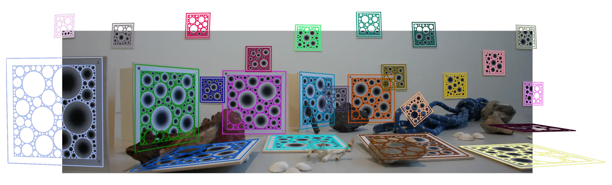
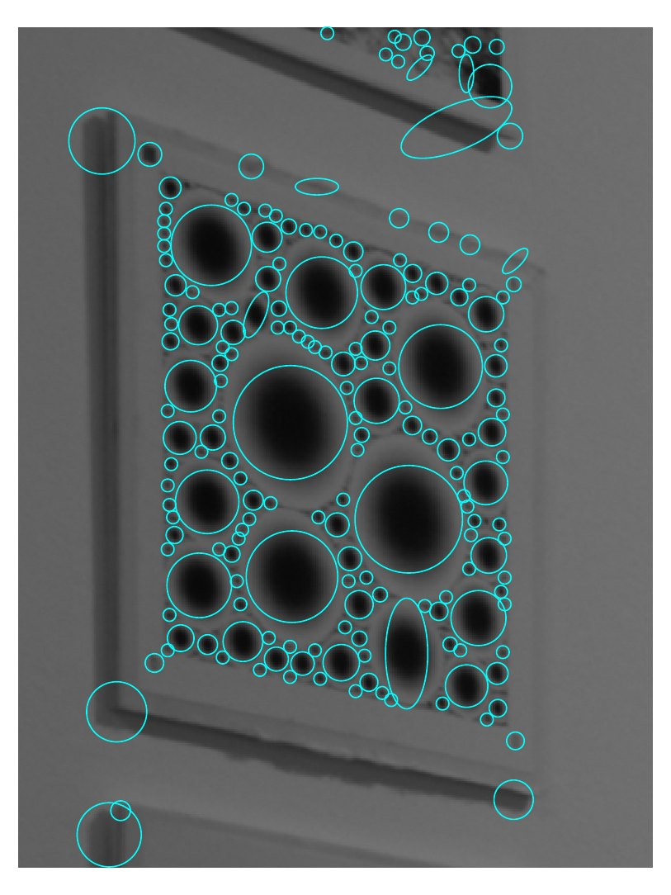
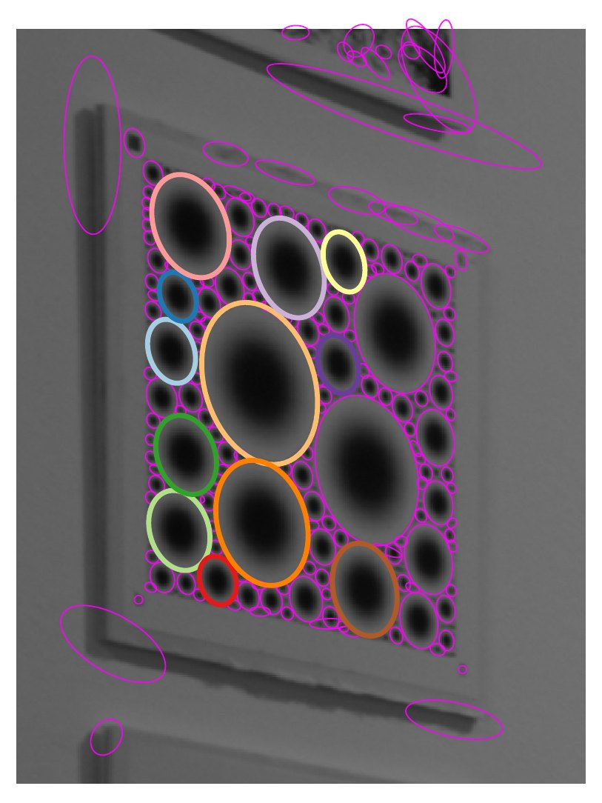
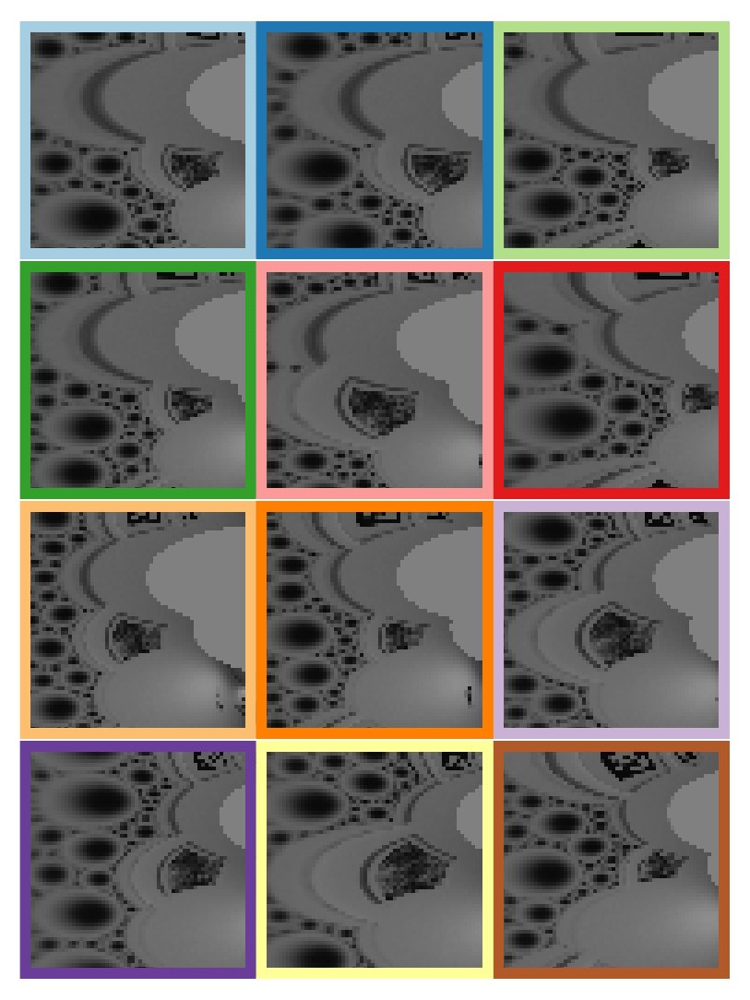
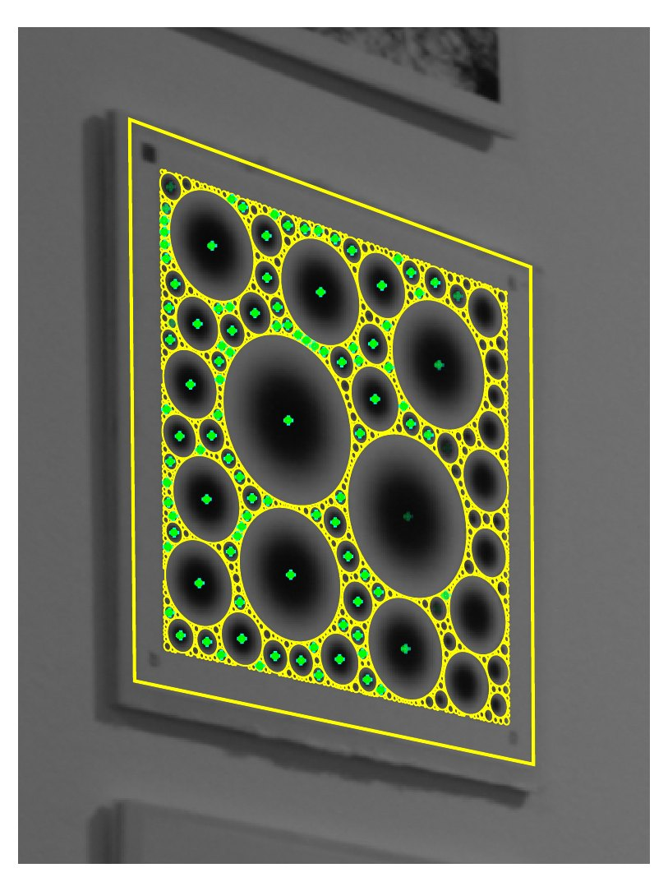

```@raw html
---
layout: home
hero:
  name: BlobBoards
  text: Robust Markers for Accurate Pose
  tagline: |-
    James Pritts, Till Sittart, Hendrik Sauer, Silja Janßen, Felix Seegräber, David Nakath, Kevin Köser
    Marine Data Science
    Kiel University
    BMVC 2026
  image:
    src: /assets/landing/hero_board.svg
    dark: /assets/landing/hero_board_dark.svg
    alt: A square BlobBoard, a multi-scale field of Gaussian blobs with uid glyphs in three corners and a QR code in the fourth.
  actions:
    - theme: brand
      text: Getting started
      link: /guide/getting-started/
    - theme: alt
      text: Paper
      link: https://arxiv.org/pdf/2608.28830
    - theme: alt
      text: API Reference
      link: /api/public/
    - theme: alt
      text: Code
      link: https://github.com/VisualGeometryToolkit/BlobBoards.jl
features:
  - icon: 🖨️
    title: Author a board
    details: "`blob_board` renders a printable PDF board in physical units (`mm`, `inch`) from a seed, with rulers to check the print scale and a JSON sidecar that reproduces it."
    link: /guide/boards/
  - icon: 🎯
    title: Detect boards and estimate pose
    details: "`find_boards` finds every board in an image, identifies it against your gallery, and returns its pose — verified by hundreds of blob correspondences."
    link: /guide/detection/
  - icon: 🐍
    title: Use it from Python
    details: The `blobboards` package gives the same board authoring and detection in Python, returning NumPy arrays and dataclasses.
    link: /guide/python/
---
```

A dense, multi-scale field of Gaussian blobs and a feature-based pipeline for joint detection, identification, and pose estimation.



*All 25 BlobBoards in the image are detected, identified, and registered against a
50-board gallery — 25 of its entries are absent confusers, and identification is still
perfect. Colour distinguishes detections; the overlaid pattern shows registration
accuracy across large variations in scale, distance, and obliquity.*

## Abstract

We propose BlobBoards, a fiducial marker system comprising a dense, multi-scale field
of Gaussian blobs and a feature-based pipeline for joint detection, identification, and
pose estimation. Each board is registered from hundreds of blob features whose dense
spatial coverage constrains pose, while multiple scales preserve detectability across
large changes in focal length, distance, and obliquity. Learned local descriptors are
matched to the reference pattern and spatially verified, so the correspondences
determine pose and certify identity. Against motion-capture ground truth, BlobBoards
achieve median translation errors of 3.6–5.0 mm, reducing AprilTag's median translation
error by 89% on small boards and 70% on large ones. They also produce far fewer
large-rotation failures than state-of-the-art tag systems. BlobBoards achieve the
highest detection rate, 80% versus 74% for AprilTag and 58% for ArUco, with the largest
margin on the smallest markers. Under 50% occlusion, they still detect 69% of boards
with essentially unchanged median translation error, while AprilTag and ArUco detect
none.

## Install

Copy the command for your language and install method.

### Julia

**From a checkout** — Julia 1.12+ is the only prerequisite; then `using BlobBoards`:

```bash
git clone https://github.com/VisualGeometryToolkit/BlobBoards.jl && cd BlobBoards.jl && julia --project=. -e 'using Pkg; Pkg.instantiate()'
```

**Pkg** — from CauRegistry, where BlobBoards and its stack live until they
are registered in General (Julia 1.12+):

```julia
using Pkg
Pkg.Registry.add(url = "https://github.com/prittjam/CauRegistry.jl")   # once
Pkg.add("BlobBoards")
```

### Python

**pixi** — its `py` environment provides Python with the `blobboards` package
(Julia itself is a prerequisite); the example writes an A4 board to the
current directory:

```bash
git clone https://github.com/VisualGeometryToolkit/BlobBoards.jl && cd BlobBoards.jl && pixi run -e py python python/examples/boards/generate_a4_board.py
```

**pip** — installs `blobboards` with its `juliacall` and `numpy` dependencies into
your current Python environment:

```bash
git clone https://github.com/VisualGeometryToolkit/BlobBoards.jl && cd BlobBoards.jl/python && pip install -e .
```

## Getting started

Install BlobBoards and generate, print and detect your first board in
[Getting Started](guide/getting-started.md). [Authoring boards](guide/boards.md) covers
every board option and printing; [Detecting boards](guide/detection.md)
covers `find_boards`, pose estimation and GPU acceleration. The [Overview](overview.md)
introduces patterns, boards and the coordinate conventions.

```julia
using BlobBoards

# A4 board, smallest printed disc 4 mm across → board PDF + JSON in ./out
blob_board("A4"; blob_sizes = (4.0mm, 0.2short_side), seed = 0xBEEF, dir = "./out")

# Or a pixel pattern for simulation and training
blob_pattern(800, 600; blob_sizes = (12px, nothing), seed = 0x1234, dir = "./out")
```

## Method

A board is registered from hundreds of blob features, not from four corners — that is
where the accuracy and the occlusion robustness come from.

| (a) | (b) | (c) | (d) |
|:---:|:---:|:---:|:---:|
|  |  |  |  |

*(a) **Detect:** affine detections from the ASIFT scale space. (b) **Adapt:** IRLS adaptation to anisotropic
ellipses; the twelve pose inliers are coloured individually. (c) **Canonicalize:** those inliers
mapped to 64×64 log-polar patches. (d) **Match & verify:** descriptors matched and spatially
verified; the pattern projected under the recovered pose, with reference blob centres in
green at opacity proportional to their geometric consistency.*

- **Generate.** A seeded pattern packs blobs from several octaves of scale into one
  field. The same seed reproduces the same board, in Julia or Python.
- **Adapt and register.** Each detected blob gets a fitted elliptical frame, is
  canonicalized into a patch, and described by a learned log-polar network. Matches to
  the reference pattern are spatially verified, so the correspondences determine pose
  and certify identity.
- **Evaluate.** Poses are scored against motion-capture ground truth on a rig of boards
  at a range of sizes, distances, and angles, alongside AprilTag and ArUco.

## Results

Against motion-capture ground truth, compared with AprilTag and ArUco on the same rig:

| | |
|---:|:---|
| **80%** | boards detected — AprilTag 74%, ArUco 58% — with the largest margin on the smallest markers |
| **3.6–5.0 mm** | median translation error, small to large boards |
| **−89%** | AprilTag's median translation error on small boards (−70% on large ones) |
| **69%** | boards still detected at 50% occlusion, with essentially unchanged median translation error; AprilTag and ArUco detect none |

## Data & models

Everything BlobBoards hosts lives in one Zenodo record,
[doi:10.5281/zenodo.21998310](https://doi.org/10.5281/zenodo.21998310) (the concept DOI;
it always resolves to the latest version): the paper's data, the descriptor network
weights and the example data the package ships.

- **Reproducing the BMVC results.** Everything the paper's numbers were computed from
  is archived at [doi:10.5281/zenodo.21998311](https://doi.org/10.5281/zenodo.21998311):
  the absolute-pose captures with camera calibrations, motion-capture ground truth and
  hand-eye calibrations; the AprilTag and ArUco baseline detections; the 0–90%
  occlusion series; the frozen descriptor training set; and the network the reported
  poses were produced with. It is packaged as sha256-pinned Julia artifact tarballs
  that `bmvc2026/Artifacts.toml` fetches lazily.
- **Network weights and example data.** The same record holds the ONNX descriptor
  networks and the boards, still image and video the bundled examples run on. The
  package's `Artifacts.toml` is an add-only, hash-pinned catalog of them, each entry
  fetched lazily from a numbered version of the record.

## Related projects

Part of the [Visual Geometry Toolkit](https://visualgeometrytoolkit.github.io), Julia packages for robust visual geometry from Kiel University:

- [RANSAC Scoring Done Right](https://ransacscoringdoneright.github.io): marginalize the scale, then choose the inliers (NeurIPS 2026)
- [Robust Local Optimization Done Right](https://localoptimizationdoneright.github.io): score sharp, refine soft (ACCV 2026)

## Citation

BlobBoards is described in *BlobBoards: Robust Markers for Accurate Pose*, BMVC 2026
([PDF](https://arxiv.org/pdf/2608.28830), with supplementary material). If you use this
project for your research, please cite:

```bibtex
@inproceedings{pritts2026blobboards,
  author    = {Pritts, James and Sittart, Till and Sauer, Hendrik and
               Jan{\ss}en, Silja and Seegr{\"a}ber, Felix and
               Nakath, David and K{\"o}ser, Kevin},
  title     = {{BlobBoards}: Robust Markers for Accurate Pose},
  booktitle = {British Machine Vision Conference (BMVC)},
  year      = {2026},
  eprint    = {2608.28830},
  archivePrefix = {arXiv},
}
```

The default homography path needs no additional citation. The opt-in calibrated P3P
path of `find_boards` (`PoseGeometry`) runs the published solver of Ding et al.
(CVPR 2023); if you use it, please also cite:

```bibtex
@inproceedings{ding2023p3p,
  author    = {Ding, Yaqing and Yang, Jian and Larsson, Viktor and
               Olsson, Carl and {\AA}str{\"o}m, Kalle},
  title     = {Revisiting the {P3P} Problem},
  booktitle = {IEEE/CVF Conference on Computer Vision and Pattern Recognition (CVPR)},
  pages     = {4872--4880},
  year      = {2023},
}
```

## Support

Please use the [GitHub issue tracker](https://github.com/VisualGeometryToolkit/BlobBoards.jl/issues)
for bug reports, questions, and feature requests. The repository's `examples/`
directory has runnable Julia scripts for generation, detection, tracking and building
training tracks; `python/examples/` covers the Python package.

## Acknowledgments

James Pritts is funded by Kiel Training for Excellence, an EU Horizon Europe programme
under the Marie Skłodowska-Curie Actions (MSCA), grant agreement No. 101081480, and by KMS
Kiel Marine Science – Centre for Interdisciplinary Marine Science at Kiel University. The
motion-capture setup was funded through the project OP der Zukunft as part of the
REACT-EU program and provided by the Kurt Semm Centre for laparoscopic and
robot-assisted surgery at the University Hospital of Schleswig-Holstein.
